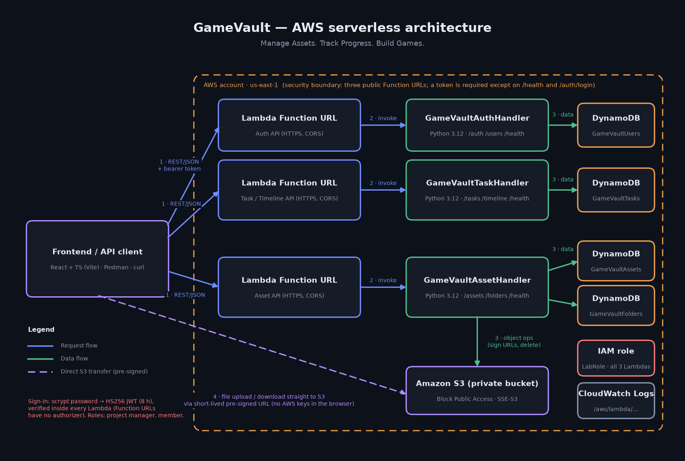

# GameVault

**Manage Assets. Track Progress. Build Games.**

Lightweight game-development workspace for small indie teams: asset library (Assets), Kanban task board (Tasks) and Gantt-style schedule (Timeline). Built on an AWS serverless stack.

> Status: **All five roadmap phases implemented**: Asset CRUD + nested folders + S3 upload/download/preview (images, audio, `.glb` 3D), Task API + Kanban, Timeline API + Gantt chart, plus tests, diagram and verification tooling. See [docs/testing.md](docs/testing.md).

## Architecture



Request flow: client → Lambda Function URL (Auth, Task or Asset API) → Lambda → DynamoDB / S3 (files travel straight between the browser and S3 through pre-signed URLs). Regenerate the diagram with `.venv/bin/python scripts/make_architecture.py` (it also refreshes the copy shown on the Docs page).

Security boundaries: the bucket is private (Block Public Access on, SSE-S3); the browser never sees AWS credentials; only the Lambda role can reach DynamoDB/S3.

### Deviation from the original spec: Lambda Function URL instead of API Gateway
The Learner Lab account denies `apigateway:POST` (creating any API), so a Lambda **Function URL** is used as the HTTP entry point. Routing is done in `handler.py`, and the event format (payload v2) is identical to API Gateway HTTP API, so switching to API Gateway later only needs an integration, no code change.

Also in Learner Lab: IAM roles cannot be created, so `LabRole` is used. Least-privilege per function is documented as the target design but not enforced in this environment.

## Limitations (MVP)
- **Authentication is verified in the Lambdas, not by the Function URL.** The URLs stay public (`AuthType NONE`, no API Gateway authorizer in this lab), so every Lambda checks the bearer token itself; only `/health` and `/auth/login` are open. Tokens are stateless: a deleted account or changed role takes full effect when the token expires (8 h, `TOKEN_TTL_SECONDS`). There is no login rate limiting.
- CORS allows `*` (the token is sent in a header, not a cookie).
- The frontend runs locally (`npm run dev`); it is not hosted on AWS, because a static-website bucket would have to be public and the Learner Lab denies CloudFront/API Gateway.
- List endpoints use DynamoDB `Scan` (fine for small datasets; add a GSI if it grows).

## Project layout
```
backend/asset-handler/   handler.py (routing) · database.py (DynamoDB) · storage.py (S3, pre-signed URLs) · validation.py · filetypes.py · folders.py (tree rules)
backend/task-handler/    handler.py · database.py · validation.py · timeline.py
backend/auth-handler/    handler.py (login, /users) · database.py (GameVaultUsers) · validation.py
backend/shared/auth.py   scrypt password hashing, HS256 JWT, roles (bundled into all three Lambda zips)
frontend/                React + TypeScript + Vite + Tailwind (Tasks Kanban board, Timeline Gantt chart)
scripts/deploy.py        idempotent provisioning + deploy (boto3)
scripts/seed_admin.py    creates the first project-manager account
scripts/deploy_all.sh    one-shot deploy: tables, Lambdas, .env.local, health, 1 PM + 3 members
tests/                   pytest + moto unit tests
docs/                    design brief, database design, API docs, evidence/
```

## Run tests
```bash
python3 -m venv .venv && .venv/bin/pip install boto3 pytest moto
.venv/bin/python -m pytest tests -q
```

## Deploy
**Shortcut:** `scripts/deploy_all.sh` (add `--smoke` for the live smoke test, `--no-users` to skip accounts) runs steps 2-4 below with the right profile for each step, writes `frontend/.env.local` from `.aws/outputs.json`, and creates one project manager plus three members (emails via `GV_ADMIN_EMAIL` / `GV_MEMBER_EMAILS`, passwords prompted or from `GV_ADMIN_PASSWORD` / `GV_MEMBER_PASSWORD`). It needs both `[default]` and `[awsstudent]` in `.aws/credentials`, in the same AWS account.

1. Start the Learner Lab and copy the CLI credentials (`aws_access_key_id`, `aws_secret_access_key`, `aws_session_token`) into `.aws/credentials` (git-ignored) and `region=us-east-1` into `.aws/config`.
2. Run:
   ```bash
   export AWS_SHARED_CREDENTIALS_FILE=$PWD/.aws/credentials AWS_CONFIG_FILE=$PWD/.aws/config
   .venv/bin/python scripts/deploy.py
   ```
   It creates/updates the DynamoDB tables, private S3 bucket, the three Lambdas (Asset, Task, Auth) and their Function URLs, and writes the URLs to `.aws/outputs.json`. It also generates the JWT signing key once into `.aws/jwt-secret` (git-ignored, reused on every redeploy so sessions survive; `GV_JWT_SECRET` overrides it).
   The `voclabs` role cannot `CreateTable` or write DynamoDB items directly: create the tables with `AWS_PROFILE=awsstudent .venv/bin/python scripts/deploy.py --tables-only` first.
3. Create the first project manager (no public registration; the password is prompted without echo, or taken from `GV_ADMIN_PASSWORD`):
   ```bash
   AWS_PROFILE=awsstudent .venv/bin/python scripts/seed_admin.py --email you@example.com --name "Your Name"
   ```
   Further accounts are added by a project manager on the **Team** page.
4. Smoke test: `curl $ASSET_URL/health`, `curl $TASK_URL/health`, `curl $AUTH_URL/health` (or open the Connectivity page).

## Frontend
```bash
cd frontend
cp .env.example .env.local   # fill in assetApiUrl / taskApiUrl / authApiUrl from .aws/outputs.json
npm install && npm run dev
```
**Sign-in and roles.** Everything except Docs and Connectivity requires signing in (email + password). Two global roles (one project per deployment): **project manager** can do everything (create/delete tasks, set dates and assignees, delete assets and files, manage folders, manage accounts on the Team page); **member** can read everything, add and edit assets and upload files, create tasks (assigned to themselves automatically) and edit the title, description, category, priority and status of tasks assigned to them. The UI hides what a role may not do, but the Lambdas enforce it (401/403). The Connectivity round-trip test writes and deletes data, so it needs a project-manager sign-in; the health test is public.

Assets: nested folders (create/rename/move/delete-when-empty, breadcrumb, drag an asset onto a folder to move it), grid/list view, search (across all folders) + category/status filters, create/edit/delete, direct-to-S3 upload with progress, download, and inline preview: images (thumbnails), audio, and **`.glb` 3D models** (interactive rotate/zoom via `<model-viewer>`, loaded lazily). Clicking an asset opens a two-column dialog: a large preview on the left (a newly chosen file previews before it is uploaded) and the details (name, category, status, folder, assignee, description) on the right. In the grid, `.glb` models get a rendered thumbnail: models are rendered one at a time in the browser, captured as a PNG and cached in IndexedDB by S3 key, so each model is rendered once per browser (not stored on the server). Other 3D formats (fbx/obj/gltf) and files are download-only.

**Docs** (`/docs`): in-app documentation of the architecture (diagram and design decisions), tech stack, data model, the full API reference (collapsible endpoints with parameters and examples; data in `frontend/src/content/apiSpec.ts`) and security notes. **Connectivity** (`/connectivity`): an interactive diagram that follows the architecture (browser → the three Function URLs (Auth, Task, Asset) → Lambdas → DynamoDB tables / S3, plus IAM and CloudWatch). Click any component for what it is, what it does in GameVault, its latest status and latency, and a plain-language hint when it fails (e.g. an expired Learner Lab session). The app checks every service quietly in the background when it loads (no animation, no log), and the page refreshes that in place when you open it if the data is older than 30 s, so the statuses are already filled in and never flash grey; the results are kept while you move around the app and a running test keeps going. **Run test** sends the real health requests and animates a packet from the browser through the Function URL and Lambda to each dependency and back, with a live "what is happening" log; the Lambda's own steps are replayed from the per-dependency results and timings it reports. **Full round-trip test** (one button) runs the same animation for real writes: it first checks your session through the Auth API, then creates and deletes a temporary asset (with a direct browser → S3 upload/download) and task. It needs a project-manager sign-in. The status bar above the diagram shows the current step and a progress line while it runs; click it to open the list of steps, one per line (done, running, not started). When the test ends the bar becomes its result (passed, or failed at step N), and a later *Run test* turns it back into the health-check summary. IAM and CloudWatch cannot be tested from the browser, so they are shown as inferred.

Timeline: simplified Gantt chart (bar position = start date, length = duration, colour = status: gray/blue/orange/green), range navigation (prev/next/today, 2 weeks to 3 months), status and category filters, red/amber highlighting for overdue and due-within-3-days tasks, and completion statistics. It calls `GET /timeline` for the visible window, so edits made on the Tasks page show up on the next load.

Kanban supports drag-and-drop between columns (optimistic update with rollback), create/edit/delete, and search/status/priority/category/assignee filters (applied client-side over the fetched list).

Credentials expire with each lab session; rerun step 1 and the script is safe to run again.

## Testing
```bash
.venv/bin/python -m pytest tests -q          # 165 backend tests (moto)
cd frontend && npm test && npm run build     # 76 unit tests + strict type-check/build
.venv/bin/python scripts/smoke_test.py       # 80 live checks against the deployed AWS stack (creates and removes its own throw-away accounts; needs the awsstudent profile)
```
A Postman collection is in `postman/`. Details and the mapping to the specification's checklist: [docs/testing.md](docs/testing.md). CI (`.github/workflows/ci.yml`) runs the backend and frontend tests on every push.

## API
See [docs/api-documentation.md](docs/api-documentation.md). Evidence of the deployed run: [docs/evidence/](docs/evidence/).
