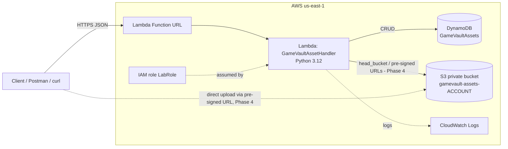

# GameVault

**Manage Assets. Track Progress. Build Games.**

Lightweight game-development workspace for small indie teams: asset library (Assets), Kanban task board (Tasks) and Gantt-style schedule (Timeline). Built on an AWS serverless stack.

> Status: **Phase 1 (Week 12 MVP)** — Asset CRUD API deployed. Tasks, Timeline, upload/download and frontend are in later phases (see `plan.md`).

## Architecture



Security boundaries: the bucket is private (Block Public Access on, SSE-S3); the browser never sees AWS credentials; only the Lambda role can reach DynamoDB/S3.

### Deviation from the original spec: Lambda Function URL instead of API Gateway
The Learner Lab account denies `apigateway:POST` (creating any API), so a Lambda **Function URL** is used as the HTTP entry point. Routing is done in `handler.py`, and the event format (payload v2) is identical to API Gateway HTTP API, so switching to API Gateway later only needs an integration, no code change.

Also in Learner Lab: IAM roles cannot be created, so `LabRole` is used. Least-privilege per function is documented as the target design but not enforced in this environment.

## Limitations (MVP)
- **No authentication.** The Function URL is public (`AuthType NONE`); anyone with the URL can call the API. Acceptable only for the academic MVP.
- CORS allows `*` for development.
- List endpoints use DynamoDB `Scan` (fine for small datasets; add a GSI if it grows).

## Project layout
```
backend/asset-handler/   handler.py (routing) · database.py (DynamoDB) · storage.py (S3) · validation.py
scripts/deploy.py        idempotent provisioning + deploy (boto3)
tests/                   pytest + moto unit tests
docs/                    design brief, database design, API docs, evidence/
```

## Run tests
```bash
python3 -m venv .venv && .venv/bin/pip install boto3 pytest moto
.venv/bin/python -m pytest tests -q
```

## Deploy
1. Start the Learner Lab and copy the CLI credentials (`aws_access_key_id`, `aws_secret_access_key`, `aws_session_token`) into `.aws/credentials` (git-ignored) and `region=us-east-1` into `.aws/config`.
2. Run:
   ```bash
   export AWS_SHARED_CREDENTIALS_FILE=$PWD/.aws/credentials AWS_CONFIG_FILE=$PWD/.aws/config
   .venv/bin/python scripts/deploy.py
   ```
   It creates/updates the DynamoDB table, private S3 bucket, Lambda and Function URL, and writes the URL to `.aws/outputs.json`.
3. Smoke test: `curl $URL/health`.

Credentials expire with each lab session; rerun step 1 and the script is safe to run again.

## API
See [docs/api-documentation.md](docs/api-documentation.md). Evidence of the deployed run: [docs/evidence/](docs/evidence/).
